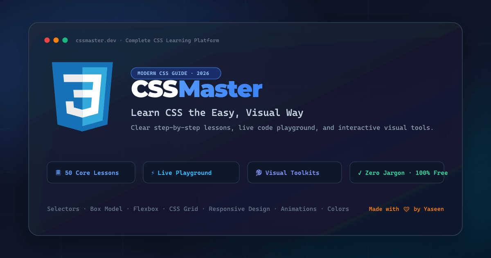

# CSSMaster — Complete CSS Learning Platform

[](https://completecssmastery.vercel.app)
[](https://nextjs.org/)
[](https://tailwindcss.com/)
[](LICENSE)

> A comprehensive, interactive, beautifully designed CSS learning ecosystem covering Cascading Style Sheets from absolute beginner fundamentals to modern layout specifications.

**🌐 Live Website:** [https://completecssmastery.vercel.app](https://completecssmastery.vercel.app)

---



---

## 🌟 Key Highlights

- **Floating Mac-Window Shell:** Signature card interface (`max-w-[1740px]`) suspended over an ambient gradient wallpaper backdrop with dual independent sidebar and content scrolling.
- **50 Comprehensive Lessons:** 21 authoritative categories (A through U) adhering to a strict 18-part lesson architecture with real-world examples, property tables, common gotchas, and knowledge-check quizzes.
- **Zero-Runtime Syntax Highlighting:** Server-side Shiki (`github-dark`) compilation at build time, eliminating heavy client-side highlighter bundles.
- **Interactive Visualizer Toolkits (`/visualizers`):** 8 dedicated interactive mathematics and layout visualizers:
  1. **Box Model Visualizer:** Live padding, border, margin sliders with `box-sizing` geometry output.
  2. **Flexbox Axes Playground:** Main/cross axis toggles, justify-content, align-items, and flex-wrap visualizer.
  3. **CSS Grid Builder:** Dynamic column/row track sizing (`1fr`, `minmax()`, `auto`), gap spacing, and live cell layout.
  4. **Specificity Battle Calculator:** Compares two CSS selectors side-by-side using the 4-tier specificity tuple `(inline, ID, class, element)`.
  5. **OKLCH Color Mixer:** Perceptually uniform color sliders (Lightness, Chroma, Hue) generating modern CSS color declarations.
  6. **CSS Gradient Studio:** Linear, radial, and conic gradient builder with multi-stop pickers and preset palettes.
  7. **Border Radius Sculptor:** Interactive corner manipulator for standard and organic non-symmetrical shapes.
  8. **Box Shadow & Elevation Simulator:** Multi-axis X/Y offset, blur, spread, alpha, and inset shadow designer.
- **Standalone CSS Lab (`/playground`):**
  - Dedicated **HTML + CSS only** execution environment.
  - Zero-script sandbox (`sandbox=""`) and automated script/event-handler neutralization.
  - Two dedicated tabs: `styles.css` and `index.html`.
  - 10 pure HTML/CSS starter templates (including pure CSS interactive accordion).
  - Viewport switcher (Desktop, Tablet, Mobile, Custom slider) and fullscreen toggle.
  - Save, load, and multi-format export modal (`SaveLoadModal.jsx`).
- **Interactive Practice Challenges & Quizzes:**
  - Hands-on code challenge input with CSS syntax validation and hint reveals.
  - 3–5 question multiple-choice knowledge checks at the end of each topic.
- **Searchable Properties Encyclopedia (`/reference`):** Searchable index of standardized CSS properties with formal syntax and inheritance data.
- **Global Command Palette:** Instant keyboard search modal (`Ctrl+K` / `⌘+K`) across curriculum lessons and CSS properties.
- **Client Persistence:** Progress tracking, lesson completion checkmarks, quiz scores, solved challenges, and bookmarks stored in browser `localStorage`.
- **Pure JavaScript & JSX:** Strict adherence to modern JS/JSX with zero TypeScript.

---

## 🚀 Getting Started

### Prerequisites
- Node.js 18.17 or later
- npm or yarn

### Installation
```bash
# Clone or navigate into the CSS directory
cd d:\MyProjects\street-of-wolves\_apps\ProgrammingLanguages\CSS

# Install dependencies
npm install
```

### Development Server
```bash
npm run dev
```
Open [http://localhost:3000](http://localhost:3000) in your browser.

### Production Build & Static Verification
```bash
npm run build
npm run start
```
All static routes are pre-rendered statically with zero errors.

---

## 📂 Project Architecture

```
CSS/
├── .agents/                    # Agent instructions & rules
│   ├── rules/                  # Design tokens, workbench rules, curriculum catalog
│   └── skills/                 # 10 specialized reusable engineering skills
├── app/                        # Next.js 16 App Router routes
│   ├── about/                  # Platform mission and architecture overview
│   ├── playground/             # Standalone sandboxed CSS Lab (HTML + CSS only)
│   ├── reference/              # Searchable CSS Properties Encyclopedia
│   ├── topics/                 # Dynamic lesson route with SSG
│   │   ├── [slug]/             # Lesson view with RightWorkbench
│   │   └── page.js             # Full curriculum index directory
│   ├── visualizers/            # 8 interactive visualizer tools suite
│   ├── globals.css             # Tailwind base and custom utility tokens
│   ├── layout.js               # Global root layout and metadataBase
│   ├── not-found.js            # Custom 404 page
│   ├── page.js                 # Homepage dashboard & progress metrics
│   ├── robots.js               # Search engine crawlers directive
│   └── sitemap.js              # Dynamic XML sitemap generator
├── assets/                     # Master SVG brand assets
├── components/                 # Reusable React components
│   ├── layout/                 # MacWindow, WindowToolbar, Sidebar, MobileDrawer, RightWorkbench, Footer
│   ├── learning/               # LessonContent, CodeBlock, Callout, EducationalTable, QuizCard, CodeChallenge, CssDemoSandbox
│   ├── ui/                     # Logo, ThemeToggle, SearchModal
│   └── visualizers/            # BoxModel, Flexbox, Grid, Specificity, OKLCH, Gradient, BorderRadius, Shadow
├── data/                       # Curriculum data
│   ├── lessons/                # 50 fully authored JavaScript lesson modules
│   ├── playgroundTemplates.js  # 10 pure HTML/CSS starter templates
│   ├── properties.js           # Standardized CSS properties catalog
│   └── topics.js               # Master catalog across 21 categories
├── lib/                        # Infrastructure utilities
│   ├── shiki.js                # Server-side code syntax highlighter
│   ├── usePlatformShortcut.js  # Keyboard shortcut hook (Ctrl+K / ⌘+K)
│   └── useProgress.js          # LocalStorage progress and quiz engine
├── public/                     # Static icons, favicons, and OpenGraph images
├── AGENTS.md                   # Permanent project agent instructions
├── CURRICULUM_COVERAGE.md      # Matrix of all 50 lessons and 21 categories
├── GEMINI.md                   # Gemini CLI agent rules
├── PLAYGROUND_SECURITY.md      # Security specification and threat model
├── PROJECT_PROGRESS.md         # 16-phase milestone execution tracker
├── package.json
└── tailwind.config.js
```

---

## 🎨 Design System & Color Palette

The platform uses a crisp CSS Blue brand identity:

| Token | Hex Value | Usage |
| :--- | :--- | :--- |
| `brand-50` | `#EFF6FF` | Soft blue highlights & active navigation background |
| `brand-100` | `#DBEAFE` | Hover states on light pills |
| `brand-500` | `#3B82F6` | **Primary CSS Blue** (buttons, active pills, logo) |
| `brand-600` | `#2563EB` | Hover states, active links, primary emphasis |
| `brand-950` | `#172554` | Dark mode active badge background |
| `surface-dark` | `#0B1120` | Deep blue canvas background |
| `surface-darkSurface` | `#111827` | Dark mode window container background |
| `surface-darkSubtle` | `#1E293B` | Dark mode elevated surfaces and borders |

---

## 🧪 Verification & Quality Assurance

- **Build Output:** Verified static generation via `npm run build` with zero errors.
- **Accessibility:** Semantic HTML elements, accessible form labels, ARIA dialog roles, high-contrast text ratios.
- **Zero Placeholders:** Every lesson contains complete explanations, syntax, property tables, live demos, gotchas, exercises, and quizzes.

---

## 🧡 Attribution & Authorship

Made with 🧡 by **Yaseen**.
